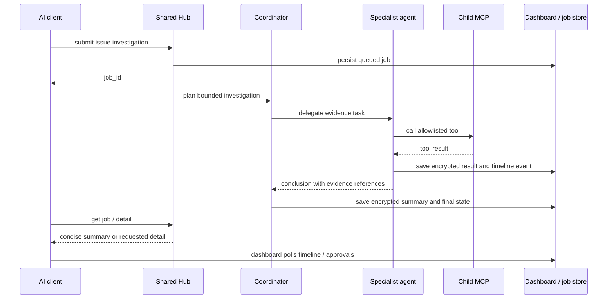

# Shared Agent Hub Design

**Status:** The approved implementation is complete in the two planned repositories. Unit tests pass. One live smoke check is blocked by missing OpenObserve STG configuration; Windows task installation and two-client manual acceptance remain pending. See the implementation plan for verification details.

**Date:** 2026-10-28

## Goal

Run one local mcp-hub service for the user's AI clients. It keeps the configured child MCPs connected, accepts asynchronous issue investigations, assigns work to role-specific AI agents, and returns a concise evidence-based summary with details available on request.

## Current state

- The Hub is a Python MCP proxy launched by each client over stdio. It connects to three configured children: logs, Jira, and PR Companion.
- Startup reads configuration and child tool schemas, then exposes the configured allowlist. Existing direct child tools are useful and should remain available.
- Each child already has a contract under `docs/mcps/`. Those contracts describe tools, permissions, data sources, and side effects.
- There is no `mcp-read-source` sibling repository yet.
- A local measurement with all three children took 5.2–5.9 seconds to initialize. The shared service should start once at user logon so clients do not each pay that cost.

## Approved decisions

### Runtime and clients

- Full service lifecycle and dashboard support Windows first. Keep the Hub's existing stdio path for development and compatibility.
- Run one background Hub per signed-in Windows user, launched by Task Scheduler at logon. Use a `hubctl` PowerShell script for status, start, stop, restart, and open-dashboard operations.
- Bind the service to `127.0.0.1`. Use MCP Streamable HTTP for clients that can provide the local bearer token; use a stdio bridge for clients that cannot.
- Keep one long-lived connection per enabled child in the Hub process. A single user's clients share the same job list and results.
- Config changes take effect after validation and an explicit restart from the dashboard or `hubctl`.

### Agent team and first workflow

- Keep current child tools directly callable by clients.
- Add one asynchronous workflow first: investigate an issue by comparing logs, registered source code, Jira history, and PR context as relevant.
- Use a coordinator agent plus logs, source, Jira, and PR specialists. Store role instructions in tracked Hub documentation; expose each specialist only its role's allowlisted child tools.
- Configure each agent independently with provider, model, and API key. Support OpenAI, Gemini, and Anthropic in the first release. The user fills keys in an ignored local configuration file; tools may report configured/not-configured state but never reveal key values.
- Keep agent execution bounded: maximum two active jobs, 15 minutes per job, and 30 child-tool calls per job. If a budget is reached, stop and return a partial result with the reason.
- Specialists return evidence and a short conclusion to the coordinator. Do not expose private chain-of-thought in the MCP response or dashboard; show observable actions, tool calls, status, evidence, and conclusions.

### Job API

Add these Hub tools while keeping all existing tools:

- `hub__submit_issue(project, question, env?, issue_key?, rcid?)` returns `{job_id, status}` immediately.
- `hub__get_job(job_id)` returns state, summary, agent statuses, and evidence references.
- `hub__get_job_detail(job_id, source_id, offset?, limit?)` returns a bounded page of one stored tool result.
- `hub__provide_job_input(job_id, env)` resumes a job in `awaiting_input` after validating the environment against the registered project.
- `hub__approve_job(job_id, code)` approves the exact pending write represented by the job's pending operation.
- `hub__cancel_job(job_id)` cancels a queued, awaiting-input, running, or awaiting-approval job.

Valid states: `queued`, `awaiting_input`, `running`, `awaiting_approval`, `completed`, `partial`, `failed`, `interrupted`, and `cancelled`. On service restart, a job that was still running becomes `interrupted`; it is not replayed automatically. Jobs waiting for approval remain pending until approved or cancelled. Approval codes are single-use, expire after 10 minutes, and are never returned to the model or written to logs.

If the caller omits `env`, use the registered project's default. If neither is present, set the job to `awaiting_input` and do not query logs until the caller supplies an environment. `awaiting_input` is a pre-job validation state and does not consume the model-call budget.

### Source reader child

- Create a separate Python child repository named `mcp-read-source` as a sibling of the Hub. It is the second repository requiring code: this repository does not currently exist.
- Register projects explicitly in the source child configuration. Each project has a stable alias and local repository root; clients send the alias, never a machine path.
- Expose read-only `source__search(project, query, glob?, limit?)` and `source__read(project, path, start_line?, max_lines?)` tools.
- Reject paths outside the registered root after resolving symlinks. Skip `.git`, dependency/build/cache directories, environment files, private configuration, binary files, and files over 1 MiB. Limit each search to 500 files and each read to 200 lines.
- The source child has its own agent contract, health check, template, and tests. It must not write source files or run repository commands.

### Side effects and approval

- Permit documented encrypted local cache writes made automatically by read workflows. Current examples include the logs read-through cache, Jira ticket cache, and PR context cache.
- Require user approval before any explicit write action or any write to an external service. The Hub intercepts these calls, records a pending operation, and does not execute it until approval.
- Apply this approval gate to agent-originated calls inside investigation jobs. Existing direct child tools keep their current behavior and MCP annotations; their own contracts continue to govern direct client calls.
- The dashboard can approve directly. To approve from an AI client, the user copies a one-time code shown only in the dashboard and enters it in chat; the model cannot invent or retrieve it.
- Keep child `readOnlyHint` annotations and child contracts authoritative for call shape, then add a Hub side-effect policy that separately labels allowed local caches and approval-required operations.

### Dashboard, privacy, and storage

- Serve a small browser dashboard from the Hub on localhost, using plain HTML/CSS/JavaScript and the existing Python web stack. Do not add a frontend framework.
- Show service health, enabled child status, each agent's provider/model/configuration status, the shared job list, job timeline, tool names and timings, approval state, concise summary, and paginated details.
- Store job metadata and events in SQLite. Encrypt each full tool result and detailed summary with Windows DPAPI before persisting it. Do not persist API keys in the job database.
- Retain job details for 30 days and purge expired rows at startup and once per day. Keep audit logs metadata-only; never log tool arguments/results, model inputs, API keys, or approval codes.
- Send only relevant, bounded excerpts to provider APIs. Before sending, apply credential redaction and field/path filtering. Keep the full result encrypted locally. Display citations that identify the child tool and relevant line/record references.
- Protect MCP HTTP and dashboard controls with a local bearer token stored in ignored private configuration. Check Host and Origin. The bridge reads the token locally and does not expose it to the model. `hubctl open` pairs the browser through a short-lived one-time token and establishes a local dashboard session.

## Data flow

## Failure behavior

- One unavailable child marks only the dependent specialist unavailable. The coordinator may return a partial answer if remaining evidence is sufficient and must name missing evidence.
- Missing provider key marks only that agent unavailable. Direct tools and other configured agents remain usable.
- Provider timeout, rate limit, malformed tool arguments, child error, storage error, and expired approval each become visible job events with a safe summary. Do not retry a tool call automatically unless the provider response is known to be a transient API failure before tool execution.
- If service startup fails, `hubctl status` reports the task and health endpoint state; the dashboard cannot be relied on to control a stopped process.
- The Hub is single-user and local-only in v1. LAN/public serving, multi-user authorization, 2D animated UI, arbitrary workflow generation, and automatic provider failover are out of scope.

## Repositories and files expected to change

1. **`mcp-hub`**: service lifecycle/transports, job runtime/storage, model adapters, dashboard, configuration/security helpers, client bridge, documentation and tests.
2. **New sibling `mcp-read-source`**: read-only source MCP, project-root configuration, its contract, health check and tests.
3. **Existing logs, Jira and PR child repositories**: no code change is required for v1. Their current tools and documented cache behaviors are reused. Add child-code changes only if a concrete contract gap is found during integration review.
4. **AI client settings**: the user's existing per-client config files will need migration to HTTP or the stdio bridge; these are not repository code. Document migration but do not edit user-level settings as part of this project without a separate request.

## Acceptance criteria

- A single Windows user-logon task starts one Hub process and all configured children; `hubctl` and the dashboard accurately report health and can stop/restart it.
- Two compatible clients can connect simultaneously and see the same tools and job records. An unsupported HTTP client works through the bridge.
- A scripted issue investigation creates a job immediately, calls only configured tools, emits visible progress, and ends in a concise answer with evidence and optional detail retrieval.
- A missing environment, child, or provider key never causes the workflow to guess or call an unrelated source; the job asks for input or returns partial state.
- An explicit write remains pending until dashboard approval or a valid one-time code; invalid, reused, or expired codes do not execute it.
- Raw result details are encrypted at rest, expire after 30 days, and do not appear in Hub audit logs or dashboard summaries unless requested.
- Existing direct child tools remain listed with unchanged names, schemas, and annotations.
- Localhost requests without a valid token cannot call tools, view job details, approve writes, or control the service.
